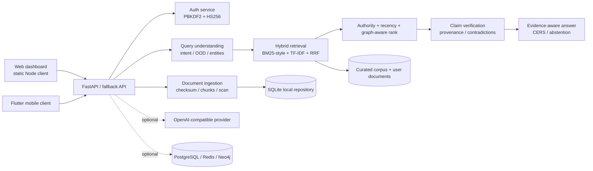

# CyberSecRA-X system architecture

## Core trust boundary

Documents are data. They are never treated as system or developer instructions. Every answer carries a chain:

`claim -> chunk -> document -> source URL -> publication/update metadata -> retrieval timestamp`

## Current implementation versus adapters

The local increment implements the query-to-evidence path with standard-library algorithms. FastAPI, PyMuPDF, SQLAlchemy, PostgreSQL/pgvector, Redis, Neo4j, transformer embeddings, cross-encoder reranking, and an approved LLM provider are pinned as opt-in dependencies. `/health/detailed` reports the local degraded mode rather than implying those services are connected.
